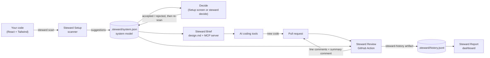

# Steward

## What it is

Steward is a design system that maintains itself. It finds the colors, spacing and components a React + Tailwind app already uses, turns them into a shared system, gives that system to AI coding tools, and checks pull requests against it. It's for small product teams at startups and SMBs that ship quickly, often with AI tools, and have no one whose full-time job is the design system.

## The problem it solves

Small teams need their UI to stay consistent as they ship, but they don't have the people or time to maintain a design system. Today's design system tools assume a dedicated team and an enterprise budget. So adoption stalls, design and code drift apart, and AI-generated UI adds inconsistency faster than anyone can fix it.

Steward takes over the upkeep, not the decisions. People still decide what the system is: they accept or reject merges, mark exceptions as intentional and approve new tokens. Owning the system becomes a part-time role. Exceptions a team chooses on purpose are shown as healthy, not as drift.

Everything runs on your machine or in your own CI, and no code is sent to an outside service. Steward measures your UI, not your people: it never stores names, emails, usernames or per-person metrics.

Steward currently supports React + Tailwind (including shadcn/ui-style) apps written in TypeScript.

## Quick Start (2 minutes)

**Prerequisites:** git, Node 20 or later, pnpm 12, and macOS or Linux (the steps use `rsync`). [TODO: confirm the 2-minute time on a clean machine; `pnpm install` time depends on your connection.]

The repo includes `fixtures/messy-app`, a deliberately inconsistent sample app. Its committed system already has every decision made, so the steps below scan a fresh copy.

1. Clone and install.

   ```sh
   git clone https://github.com/kelseythejackson/steward.git
   cd steward
   pnpm install
   ```

   Success: pnpm finishes with `Done in …` and no errors.

2. Make a fresh copy of the sample app, without its Steward files.

   ```sh
   mkdir -p ~/steward-try
   rsync -a --exclude .steward --exclude FIXTURE_NOTES.md fixtures/messy-app/ ~/steward-try/messy-app/
   ```

   Success: `~/steward-try/messy-app/src` exists.

3. Scan it (Steward Setup).

   ```sh
   pnpm steward scan ~/steward-try/messy-app
   ```

   Expected output (abridged):

   ```text
   Scanned 17 files
   Colors: 24 colors → 17 tokens (14 grays → 9, 4 blues → 2)
   Spacing: 16 values → 7-step scale from the Tailwind values you use most (9 are off the scale and could snap to it); …
   Components: 13 components, 2 groups of likely duplicates (5 components); …
   Accessibility: 9 of 16 color pairs fail contrast (fixes suggested), 2 elements have no visible focus style
   Wrote …/messy-app/.steward/system.json
   ```

4. See what's waiting for a decision.

   ```sh
   pnpm steward decide ~/steward-try/messy-app
   ```

   Expected: `24 suggestions are waiting for a decision: 6 color merges, 7 spacing snaps, 2 component merges and 9 contrast fixes.` Nothing has changed yet: suggestions apply only once a person accepts them.

5. Print the context file for AI tools (Steward Brief).

   ```sh
   pnpm steward context ~/steward-try/messy-app
   ```

   Expected: Markdown starting with `# acme-metrics design system`, followed by its rules, accessibility guidance, tokens and components.

6. Check code against the system (Steward Review). This uses the committed fixture, because `steward check` needs a git repo.

   ```sh
   pnpm steward check fixtures/messy-app --all
   ```

   Expected, at the end: `Found 130 things to change in 13 files (98 with an exact fix).` and `Mode: warn, so this never fails the build.`

7. Open the web app.

   ```sh
   pnpm -F web demo
   ```

   Expected: `Scanned a fresh copy of the fixture at …: 24 suggestions waiting.`, then `✓ Ready`. Open http://127.0.0.1:3000. The Setup page shows `Accept all 24 suggestions`. Stop it with Ctrl+C.

Run `pnpm steward --help` for every command and option.

## How the parts fit together

Steward has four parts that share one **system model**: `.steward/system.json` in your repo. It holds the tokens (in the W3C Design Tokens format), the component inventory, every decision people made, and short usage rules. Every part reads and writes it through `packages/model`.



**Steward Setup** (the scanner, `packages/scanner`) reads the repo and extracts the colors, spacing and components in use. It suggests merges for near-duplicate colors, a spacing scale, merges for duplicate components, and passing alternatives for color pairs that fail WCAG AA contrast. Every suggestion states its evidence, such as "ΔE 1.2, used 41 times" or "contrast 4.4:1, needs 4.5:1".

**Decide** is Setup's second step. On the Setup screen (`apps/web`) or with `steward decide`, a person accepts, rejects or adjusts each suggestion. Suggestions never apply themselves. Accepting re-scans, so the tokens and generated rules update at once, and every decision can be undone. Steward never edits your code: only `system.json` changes.

**Steward Brief** (`packages/context`) turns the system model into `design.md`, a context file for AI coding tools that includes the accessibility rules. It also runs a local MCP server with four tools: `get_tokens`, `find_component`, `get_rules` and `check_snippet`. The Brief screen shows how to connect Claude Code, Cursor or any MCP tool. It also compares what an AI tool built with and without Steward, using scored runs from `eval/`.

**Steward Review** (`packages/guard`) is a rule-based checker. It flags hardcoded colors, arbitrary spacing, raw elements the system has a component for, and basic accessibility problems, each with a suggested fix. As a GitHub Action, it comments on the lines a pull request changes, with one-click suggestions where they're safe, and posts one summary comment. It runs in warn mode by default, so it never fails the check unless you turn on error mode. Locally, run `steward check`. A person can mark a flag as intentional with a `// steward-ignore <rule>: <reason>` comment.

**Steward Report** (`apps/web`) is the health dashboard. Each Action run saves a history record as an artifact; `steward history import` brings them into `.steward/history.jsonl`. The Report shows a health score, trends and the top sources of drift, by rule and by source type (human or AI agent) only, never by person.

More detail:

- [Steward Review on GitHub pull requests](docs/github-action.md)
- [The before/after test for AI tools](eval/README.md)
- [Where the demo's Report data comes from](apps/web/demo/README.md)
- [The sample app's planted problems](fixtures/messy-app/FIXTURE_NOTES.md)
- [3-minute demo script](docs/demo-script.md)
