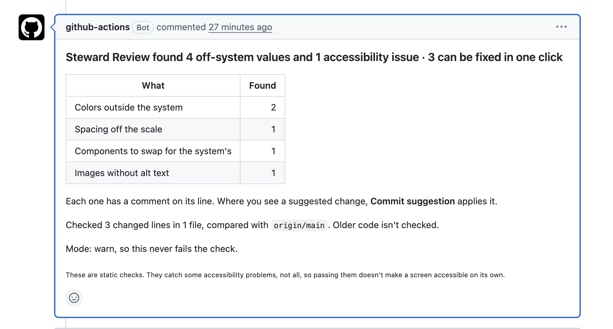

# Decision: Steward Review warns by default and never blocks

**Status:** built (November 2026). **Where:** `.steward/config.json` → `"mode": "warn"` (the default) or `"error"`.

![A Steward Review line comment with a one-click suggested change from mt-[13px] text-[#6b7280] to mt-3 text-gray-500](../images/steward-review-line-comment.png)

*Screenshots from a private test pull request (kelseythejackson/steward-review-test #1), November 2026.*

## The decision

Steward Review comments on a pull request but doesn't fail the check unless a team turns that on. In warn mode the check is green whatever happens. It stays green when Review finds problems, when GitHub refuses a comment (for example, the read-only token on pull requests from forks), and even when Steward itself can't run. In those last cases it leaves a warning on the run instead.

Teams can opt into `"mode": "error"` per repo. Even then, the check fails only for real findings on the changed lines, never for:

- a flag someone marked intentional with `// steward-ignore <rule>: <reason>`
- a repeated color that Review suggests adding as a token instead of flagging
- GitHub's API being unreachable or refusing a comment

The default comes from the project's principle "Humans decide": *Review runs in warn-only mode by default.* These notes record why we kept that default as Review grew, and how the build follows it.

## Why: false positives make people ignore tools

A check that blocks a merge for the wrong reason doesn't just waste a few minutes. It teaches the team that the tool can be wrong and that the way around it is to dismiss it, override it or switch it off. After that, the correct flags get the same treatment as the wrong ones. One bad block costs trust in every later finding.

That matters more for Steward than for most linters:

- **Static design checks are approximate, and ours have been wrong.** Building Review turned up real false positives. `bg-black/40` and `bg-black/50` were flagged as off-system even though they're the system's own see-through tokens, until we fixed it. Other limits are still there:
  - Contrast checks assume a white background where a parent component sets the real one; Setup reports 3 such pairs on the fixture.
  - Some places can't be checked at all, because their text color comes from another file (10 on the fixture).
  - Whether `gap-[10px]` is drift or fine is an open question.
  - CSS files aren't checked by Review yet.

  A blocking default would turn every one of these into a stopped merge.
- **Exceptions are part of a healthy system.** A marketing hero that needs its own button isn't a mistake. Steward's job is to make drift visible, not to make tasteful exceptions expensive.
- **Small teams have no one to appeal to.** Steward is for teams without a design-systems group. If Review blocks a release at 6pm, there's no owner on call to bless an exception, so people turn the check off.
- **Steward's voice is "a helpful colleague, not a police officer."** A colleague points things out and makes them easy to fix. A gate makes people find ways around it.

## How the build keeps warnings worth reading

Warn-only only works if the warnings are worth reading, so Review keeps noise down:

- **Only changed lines.** Old code isn't flagged on every pull request.
- **One comment per line, one summary per pull request.** New pushes edit the summary in place and never repeat a line comment that's already there.
- **Fixing is one click** where it's safe: the line comment carries a GitHub suggestion, as in the second image. Accepting the advice costs less than arguing with it.
- **Every flag explains itself** (the "Why" line) and suggests a specific fix, so a wrong flag is easy to spot and challenge.
- **Intentional means intentional.** `steward-ignore` takes a required reason and is recorded in `system.json`. A value the team keeps using becomes a token suggestion rather than a flag on every pull request.

## When to turn on error mode

Error mode is for teams that already trust the findings. A reasonable path:

1. Run in warn mode for a few weeks.
2. Look at the history. `.steward/history.jsonl` records per run how many flags were marked intentional and how many one-click fixes were accepted. Lots of exceptions on one rule suggests that rule is noisy for this codebase.
3. Turn noisy rules off in `.steward/config.json` (`"rules": { "<rule>": "off" }`), then switch to `"mode": "error"`.

## The trade-off we're accepting

Warnings can be ignored too, and in warn mode nothing forces a fix. We accept that, because a tool people trust and keep running is better than one they switched off.
