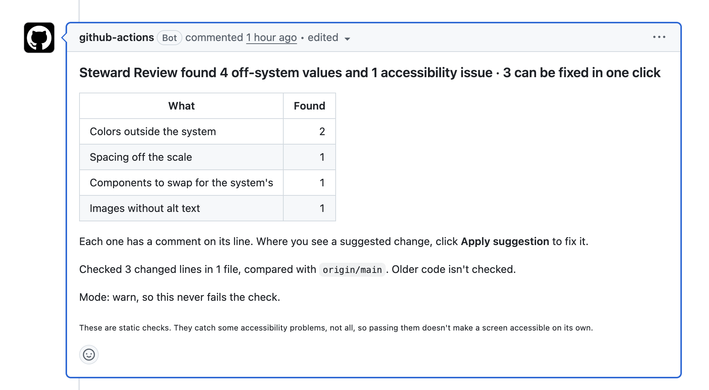
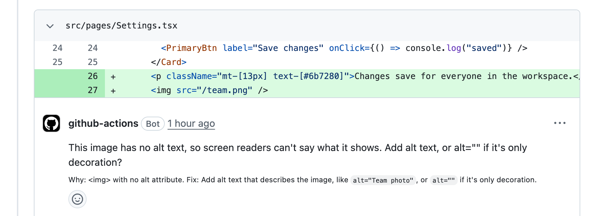

# Steward Review on GitHub pull requests

The action runs `steward check --github` on every pull request:

1. It checks only the lines the pull request changes, compared with the point
   where the branch split off its base. Older code isn't flagged.
2. It posts one review with a comment on each line that has findings. When a
   fix is safe and stays on that line (colors, spacing, focus styles, contrast),
   the comment has a GitHub suggestion, so clicking **Apply suggestion** fixes it in
   one click. Fixes that also change another line, like swapping in `Button`
   and adding its import, get advice instead.
3. It posts one summary comment, for example *"Steward Review found 4
   off-system values and 1 accessibility issue · 3 can be fixed in one
   click"*. A new push updates that comment instead of adding another one, and
   line comments already there aren't posted again. Old comments are never
   deleted, since people may have replied to them.
4. It writes the same summary to the run's summary page.
5. It saves the run's history record (counts and the code's source type only:
   `ai-agent` from an `ai-agent` label or an AI agent's bot account, `human`
   from a `human` label, otherwise `unknown`) as a small `steward-history-*`
   artifact for the Report dashboard. No names, emails or usernames are ever
   stored. Bring those records in with `steward history import`. Add
   `.steward/history.jsonl` to your `.gitignore`: it also records local
   `steward check` runs, so committing it would mix everyone's runs and
   cause merge conflicts. Local `steward check` reminds you if it isn't.

**Modes.** These are set in `.steward/config.json`, as `"mode": "warn"` or
`"mode": "error"`.

- **`warn` (the default) never fails the check.** It doesn't fail when GitHub
  refuses a comment, when the token is read-only (pull requests from forks),
  or when Steward can't run at all. Each of those shows as a warning on the
  run instead.
- **`error`** fails the check only when something is found on the changed
  lines. API problems never fail it.

**Setup.** Copy [`steward-review.yml`](github-action/steward-review.yml) to
`.github/workflows/` in the app's repo. It needs:

- `pull-requests: write` permission.
- `fetch-depth: 0`, so the base branch is available.
- A checkout of the pull request's head commit.

The repo also needs a `.steward/system.json` from `steward scan`.

---

## What it looks like

These are screenshots from a test pull request that added three off-system lines.

The summary comment, kept up to date on every push:



A line where every problem has a safe fix, so one **Apply suggestion** fixes both:

![Line comment on mt-[13px] text-[#6b7280] with a suggested change to mt-3 text-gray-500](images/steward-review-line-comment.png)

A line where only part can be fixed in one click. The color has a suggestion; swapping in `Button` also needs an import, so it gets advice:

![Line comment on a raw button: advice to use Button, and a suggested change from bg-[#2563eb] to bg-blue-600](images/steward-review-partial-fix.png)

A line with no safe fix, so the comment explains what to do and leaves it to a person:



## Testing it on a throwaway repo

You need `gh` (logged in with `gh auth login`), git and Node 20+. The test
takes about 15 minutes.

### 1. Put the action on GitHub

The workflow loads the action from the Steward repo, so the action code has to
be pushed first. Use a branch so `main` stays as it is:

```sh
cd ~/Dev/projects/steward
git switch -c github-action
git add -A && git commit -m "Add the Steward Review GitHub Action"
git push -u origin github-action
```

### 2. Make the throwaway repo from the fixture

```sh
mkdir ~/steward-action-test && cd ~/steward-action-test
rsync -a --exclude node_modules --exclude FIXTURE_NOTES.md ~/Dev/projects/steward/fixtures/messy-app/ .
git init -b main
git add . && git commit -m "Baseline"
gh repo create steward-action-test --private --source . --push
```

This includes `.steward/system.json`, so the system is already set up.

### 3. Add the workflow on `main`

```sh
mkdir -p .github/workflows
sed 's#kelseythejackson/steward@main#kelseythejackson/steward@github-action#' \
  ~/Dev/projects/steward/docs/github-action/steward-review.yml > .github/workflows/steward-review.yml
git add .github && git commit -m "Add Steward Review" && git push
```

### 4. Open a pull request with three off-system lines

```sh
git switch -c try-steward
python3 - <<'EOF'
p = "src/pages/Settings.tsx"
lines = open(p).read().split("\n")
lines[25:25] = [
    '      <p className="mt-[13px] text-[#6b7280]">Changes save for everyone in the workspace.</p>',
    '      ',
    '      <button className="bg-[#2563eb] px-4 py-2 text-white">Reset</button>',
]
open(p, "w").write("\n".join(lines))
EOF
git commit -am "Try Steward Review" && git push -u origin try-steward
gh pr create --fill
gh run watch   # pick the Steward Review run
```

The first run takes about a minute, mostly installing and building Steward.

### 5. Check what it posted

Open the pull request (`gh pr view --web`).

- **Conversation:** one summary comment headed *"Steward Review found 4
  off-system values and 1 accessibility issue · 3 can be fixed in one click"*.
  Below the heading are a table by rule, the line "Mode: warn, so this never
  fails the check", and the static-checks note.
- **Files changed:** three line comments on `src/pages/Settings.tsx`.
  - **Line 26:** spacing and color, with one suggestion that fixes both
    (`mt-3 text-gray-500`).
  - **Line 27:** missing alt text, with advice only and no suggestion.
  - **Line 28:** the raw `<button>`, with advice to use `Button`, plus a
    suggestion that fixes the color (`bg-blue-600`).
- **Checks:** "Steward Review" is green, because warn mode never fails.

### 6. Commit a suggestion and confirm nothing is duplicated

On line 26, click **Apply suggestion** and then **Commit changes**. That push
runs the workflow again. When it finishes:

- The summary is the same comment, edited. It now reads *"Steward Review found
  2 off-system values and 1 accessibility issue · 1 can be fixed in one
  click"*.
- No new line comments appear for lines 27 and 28. The line 26 comment shows
  as outdated.

### 7. Push one more off-system line

```sh
git pull
python3 - <<'EOF'
p = "src/pages/Settings.tsx"
lines = open(p).read().split("\n")
lines.insert(28, '      <span className="p-[7px]">New</span>')
open(p, "w").write("\n".join(lines))
EOF
git commit -am "One more" && git push
```

Only line 29 gets a new comment, and the summary updates again.

### 8. Try error mode

```sh
echo '{ "mode": "error" }' > .steward/config.json
git add .steward/config.json && git commit -m "Error mode" && git push
```

The check now fails (red X), and the summary says *"Mode: error, so this check
fails until these lines change…"*. Set it back to `"warn"` (or delete the
file) and push. The check goes green while the comments stay.

### 9. Optional: confirm warn mode survives a token that can't comment

In the workflow, change `pull-requests: write` to `pull-requests: read`, then
push. The check stays green, the run shows a warning that the token couldn't
comment, and all the findings are on the run's summary page. This is what
happens on pull requests from forks. Change it back afterwards.

### 10. Clean up

```sh
gh repo delete steward-action-test --yes   # may ask you to run: gh auth refresh -s delete_repo
rm -rf ~/steward-action-test
```

Then delete the `github-action` branch of Steward, or merge it, whichever
you prefer.

---

## Limits

- Only `.tsx` and `.jsx` files are checked. Stories, tests and CSS are left out.
- A suggestion can only replace the line it's on, so fixes that add an import
  (merged components) get advice instead of a one-click fix.
- Every run installs and builds Steward from source, which takes 30–60s, until
  Steward is published.
- The action sets up Node 22 for the rest of the job.
